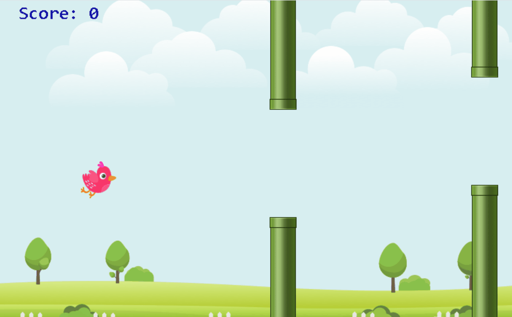

# algorithm-games
A collection of 13 algorithm mini-games built with C++ and EasyX.
# Flappy Bird (EasyX & C++)

基于 C++ 与 EasyX 图形库开发的轻量版 Flappy Bird 经典小游戏，也是我的第一个 C++ 游戏开发练习项目。

本项目参考了童晶老师的教材与教学思路，通过面向对象的设计方法实现了完整的游戏主循环、物理运动模拟、碰撞检测及透明图像渲染。

## ✨ 核心特性

- **经典物理模拟**：模拟重力加速度与跳跃冲量，还原平滑的起伏手感。
- **动态障碍物阵列**：使用 `std::vector` 管理多对水管障碍物，实现等距队列与循环复用机制。
- **碰撞判定系统**：基于 **AABB（轴对齐包围盒）** 几何逻辑，实现高效、轻量的上下水管与边界碰撞检测。
- **图像透明混合**：实现并封装针对 32 位带透明通道（Alpha 通道）PNG 贴图的渲染逻辑，解决贴图黑边问题。
- **双缓冲防闪烁**：利用 EasyX 批处理绘图机制（`BeginBatchDraw` / `FlushBatchDraw`）保障画面稳定流畅。
- **记分与状态管理**：内置防重复触发标志位，精准统计穿越水管的得分情况。

---

## 🛠️ 技术栈

- **编程语言**：C++ (C++11 及以上)
- **图形库**：[EasyX Graphics Library](https://easyx.com/)
- **开发环境**：Visual Studio 2022 / Windows SDK
## 🎮 游戏演示

